  

<table>
<tr>
<td>

I build software that takes repetitive work off people's desks — 
**AI agents, e-commerce automation, dashboards and Android apps.**

 

## ⚡ Featured work

  
  

<b>⚡ Ultron · Ecom Manager — problem, solution, stack</b>

 

| | |
|---|---|
| **Problem** | A marketplace seller's team spends hours every day pulling reports from Myntra, AJIO, Flipkart, the OMS and the ERP, and chasing SLAs and returns by hand. |
| **Solution** | 30+ automated workings on GitHub Actions, a Telegram bot that answers questions and proposes actions for one-tap approval, failure alerts with the cause, and AI auto-fix for failed runs. |
| **Stack** | Python · Cloudflare Workers · GitHub Actions · Telegram Bot API · Google Drive API |
| **Repo** | [bindalbhikan/Ultron](https://github.com/bindalbhikan/Ultron) |

<b>🔥 Ravan — goal, design, quality bar</b>

 

| | |
|---|---|
| **Goal** | Cover the head, manager, executive, returns, listings, BD and MIS roles — first for my own business, then for any seller. |
| **Design** | Go core with ports-and-adapters architecture, Python (Polars) data worker, Parquet data lake; every figure cut by portal → account → brand. |
| **Quality bar** | Every working is proven against the live system with parity tests before cut-over. |

### More projects

| Project | Description | Stack |
|---|---|---|
| [ACPLEFF](https://github.com/bhikandeshmukh/ACPLEFF) | Efficiency tracker and productivity reports for warehouse staff | Next.js · TypeScript |
| [ATND](https://github.com/bhikandeshmukh/ATND) | Geofenced attendance with working hours and monthly reports | TypeScript |
| [AirTap](https://github.com/bhikandeshmukh/AirTap) | Control an Android phone from the desktop | Kotlin |
| [EcomSpace](https://github.com/bhikandeshmukh/EcomSpace) | Website for a marketplace-automation product suite | TypeScript |
| [Dispatch Manager](https://github.com/bhikandeshmukh/dispatchmanager) | Dispatches, returns and cancellations across portals and couriers | JavaScript |
| [TaskMaster](https://github.com/bhikandeshmukh/TaskMaster) | PDF split/merge, EXIF extraction and Excel/CSV merging | Python |

<b>🛡️ Earlier open-source security tools (1.8k+ stars)</b>

 

| Project | Stars |
|---|---|
| [shark](https://github.com/bhikandeshmukh/shark) |  |
| [instarat](https://github.com/bhikandeshmukh/instarat) |  |
| [MapEye](https://github.com/bhikandeshmukh/MapEye) |  |
| [fbreport](https://github.com/bhikandeshmukh/fbreport) |  |
| [Wi-Fi-Jammer](https://github.com/bhikandeshmukh/Wi-Fi-Jammer) |  |

Published for education and authorized security testing only.

## 🧰 What I can build for you

| Service | Examples |
|---|---|
| 🤖 **AI agents & bots** | Telegram / WhatsApp assistants, report bots, approval workflows |
| 🛒 **E-commerce automation** | Bulk listings, order / return tracking, marketplace reports, SLA alerts |
| 📊 **Dashboards & data** | Excel / Parquet pipelines, MIS reports, live dashboards |
| 🌐 **Web apps** | Next.js + TypeScript apps, admin panels, PWAs |
| 📱 **Android apps** | Kotlin apps, device tools, field-staff apps |

## 🛠️ Tech stack

   
  

## 📊 GitHub activity

  
  

  

  <picture>
    <source media="(prefers-color-scheme: dark)" srcset="https://raw.githubusercontent.com/bhikandeshmukh/bhikandeshmukh/output/github-snake-dark.svg" />
    
  </picture>

🎓 B.Com — North Maharashtra University · Diploma in Hotel Management — University of Delhi

</td>
</tr>
</table>

  

